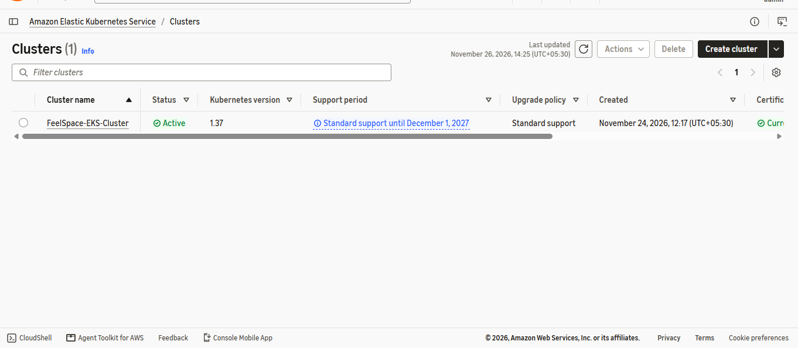
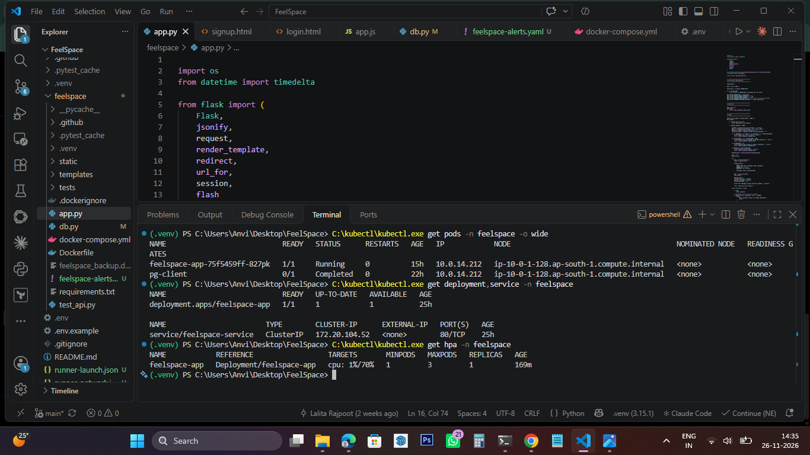
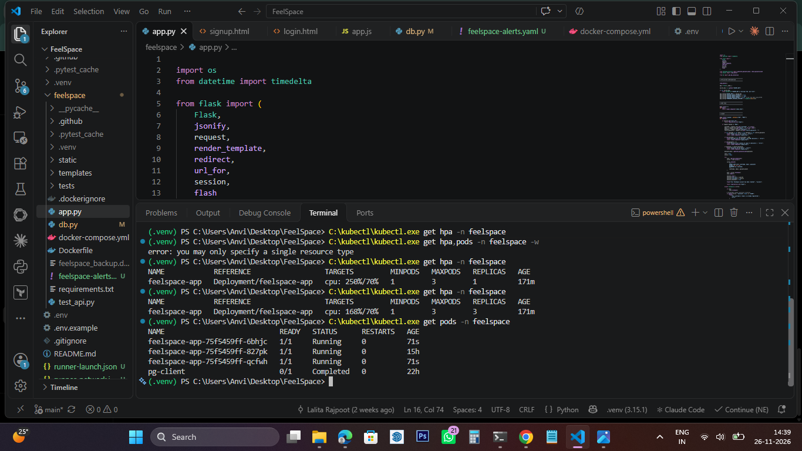
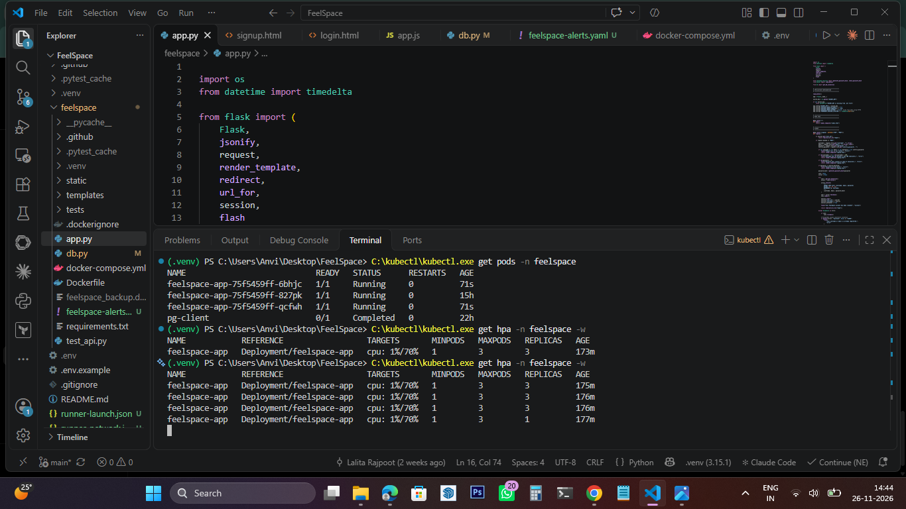
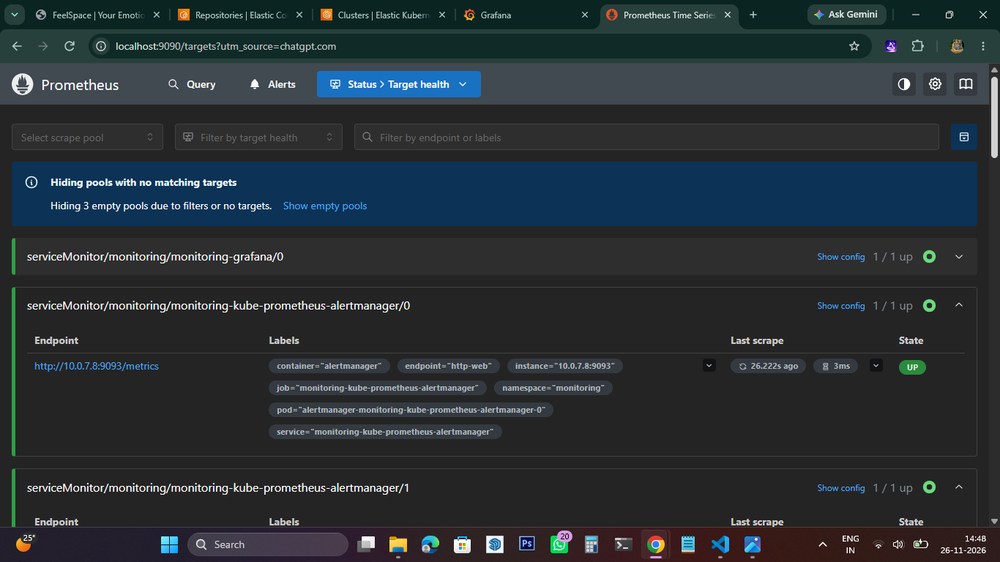
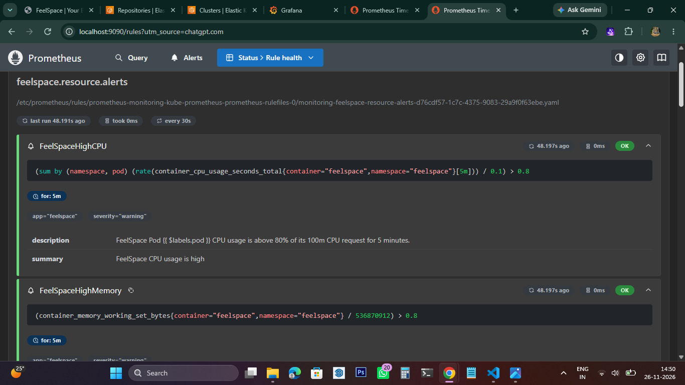
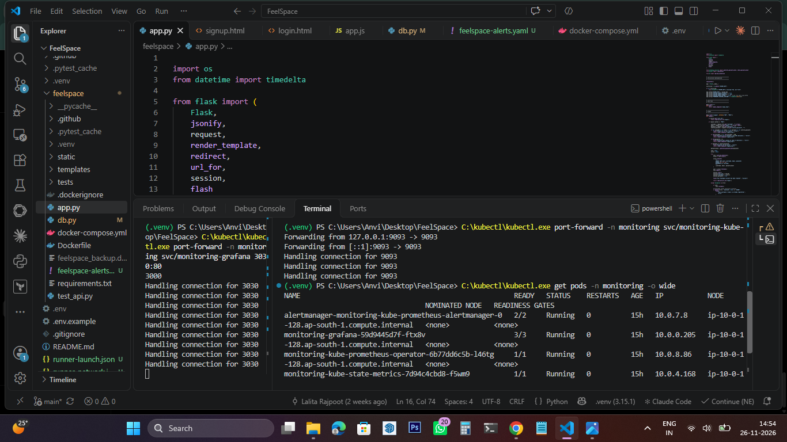
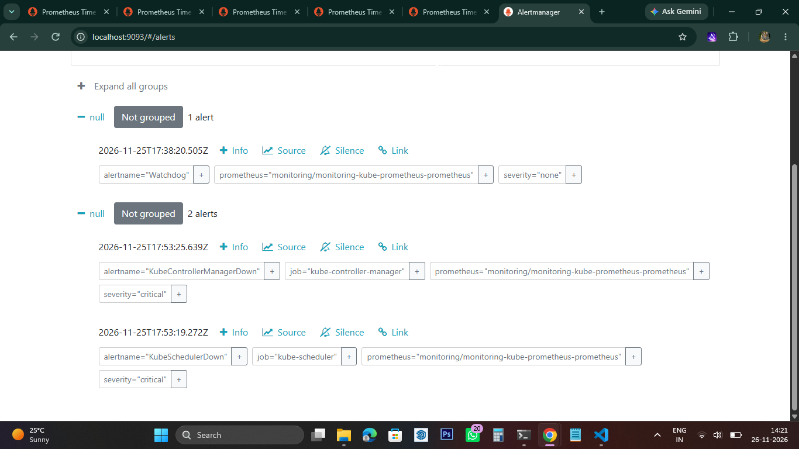

# FeelSpace
### Building a community application and taking it to AWS EKS

FeelSpace started with a simple idea: creating a space where people can share their thoughts and feelings.

While building it, I wanted to learn more than just backend development. I wanted to understand what happens after an application is written — how it gets packaged, deployed, exposed to users, monitored, and scaled when the workload changes.

That became the bigger goal of this project.

I built FeelSpace using Python, Flask, and PostgreSQL, containerized the application with Docker, and deployed it on Amazon EKS. I also worked on automating the image delivery process and setting up monitoring and resource-based scaling.

**Live Application:** [Open FeelSpace](http://k8s-feelspac-feelspac-35b29a7c3f-2097529575.ap-south-1.elb.amazonaws.com)

---

## The application

FeelSpace is a community platform where users can create accounts and share their thoughts.

The application includes user authentication, password hashing, session management, and a thought-sharing experience backed by PostgreSQL.

I used Flask for the backend because it gave me an opportunity to work with Python while understanding how application code, database connectivity, and containerized environments fit together.

## Technology choices

| Area | Technology |
|---|---|
| Backend | Python, Flask |
| Database | PostgreSQL |
| Containerization | Docker |
| Local development | Docker Compose |
| CI/CD | GitHub Actions |
| Container registry | Amazon ECR |
| Cloud | AWS |
| Orchestration | Amazon EKS, Kubernetes |
| Autoscaling | Kubernetes HPA |
| Monitoring | Prometheus, Grafana |
| Alert management | Alertmanager |
| Kubernetes monitoring setup | kube-prometheus-stack, Helm |

## How the application reaches the user

The application delivery process connects the source code repository, container image registry, and Kubernetes environment.

```text
                 Developer
                     |
                     v
              GitHub Repository
                     |
                     v
              GitHub Actions
                     |
                     v
              Docker Image Build
                     |
                     v
                 Amazon ECR
                     |
                     v
                Amazon EKS
                     |
                     v
            Kubernetes Deployment
                     |
                     v
             FeelSpace Application
                     |
                     v
              Kubernetes Service
                     |
                     v
              AWS Load Balancer
                     |
                     v
                   Users
```

The Flask application uses PostgreSQL for persistent application data.

## What I implemented

### 1. Application containerization

I created a Docker image for the Flask application and worked with Docker Compose to run the application and PostgreSQL during local development.

This helped me understand how application dependencies, environment variables, containers, and database connectivity work together.

### 2. CI/CD with GitHub Actions

I configured a GitHub Actions workflow to automate the container image build and publishing process.

The workflow connects the GitHub repository with Amazon ECR, making the application image available for deployment in the Kubernetes environment.

### 3. Deployment on Amazon EKS

I created an Amazon EKS cluster and deployed FeelSpace using Kubernetes resources.

The deployment includes:
- Kubernetes Deployment to manage application Pods.
- Kubernetes Service to expose the application.
- Application health checks.
- Container resource requests and limits.
- Amazon ECR as the image registry.

### 4. Resource management

I configured CPU and memory requests and limits for the application container.

| Resource | Request | Limit |
|---|---:|---:|
| CPU | 100m | 500m |
| Memory | 128Mi | 512Mi |

These settings help Kubernetes understand the application's resource requirements and enforce container resource limits.

### 5. Testing automatic scaling

I wanted to see how Kubernetes responds when an application receives additional workload.

For this, I configured a Horizontal Pod Autoscaler (HPA).

| Setting | Value |
|---|---|
| Deployment | feelspace-app |
| Namespace | feelspace |
| CPU utilization target | 70% |
| Minimum replicas | 1 |
| Maximum replicas | 3 |

I generated CPU load against the application and observed HPA increase the number of application replicas. I also observed the scaling behaviour after the load test.

This was useful for understanding how Kubernetes uses resource metrics to make scaling decisions.

### 6. Monitoring with Prometheus and Grafana

After deployment and scaling, I wanted to understand how to observe the application and Kubernetes environment.

I installed the kube-prometheus-stack using Helm.

The setup includes:

- **Prometheus:** collects and stores monitoring metrics.
- **Grafana:** displays metrics through dashboards.
- **Alertmanager:** manages alerts generated by Prometheus.
- **Node Exporter:** provides node-level metrics.
- **Kube State Metrics:** exposes Kubernetes resource-state information.

I checked Prometheus targets and verified that the monitoring components were running.

### 7. Custom FeelSpace alert rules

I created a custom PrometheusRule named `feelspace-resource-alerts`.

It contains two application resource rules:

- `FeelSpaceHighCPU` – monitors CPU usage against the configured CPU request.
- `FeelSpaceHighMemory` – monitors memory usage against the configured memory limit.

Both rules use an 80% threshold and a five-minute evaluation duration.

I verified that the rules were loaded in Prometheus. They were inactive during verification, so the screenshots show the configured rules rather than a simulated firing alert.

---

## Project screenshots

The following screenshots are from the running application and the AWS/Kubernetes environment used during implementation.

### 01. The application


### 02. AWS and Kubernetes deployment




### 03. Autoscaling







### 04. Monitoring and alerting











### 05. Source code and CI/CD


---

## What I learned while building FeelSpace

This project helped me connect concepts that I had previously studied separately.

Some of the most useful hands-on learning came from:
- Packaging a Python application with Docker.
- Connecting application containers with PostgreSQL.
- Building a GitHub Actions workflow for container image delivery.
- Working with Amazon ECR and EKS.
- Deploying and troubleshooting Kubernetes workloads.
- Configuring health probes and resource limits.
- Testing HPA behaviour under CPU load.
- Setting up Prometheus and Grafana.
- Writing custom Prometheus alert rules.

There are still areas I want to improve, including automated testing, centralized logging, security hardening, and deployment rollback.

I consider FeelSpace an ongoing engineering project and a practical way to improve my understanding of cloud infrastructure and DevOps workflows.

---

## Project links

- [GitHub Repository](https://github.com/lalita-15/FeelSpace)
- [Live Application](http://k8s-feelspac-feelspac-35b29a7c3f-2097529575.ap-south-1.elb.amazonaws.com)
- [LinkedIn](https://www.linkedin.com/in/lalita-rajpoot-05487521a/)

---

*Built as a hands-on Cloud and DevOps portfolio project.*