# FeelSpace
## Cloud-Native DevOps Infrastructure on AWS EKS

FeelSpace started with a simple idea: a platform where people can share their thoughts and feelings.

But I wanted to take the project beyond application development and understand what it takes to run an application in a cloud environment.

So I used FeelSpace to build and work on a cloud-based DevOps infrastructure using AWS, Docker, Kubernetes, and modern monitoring tools.

The main focus of this project is the infrastructure behind the application — how it is containerized, deployed, managed, monitored, and scaled.

---

## Project Overview

FeelSpace is a Flask-based community application backed by PostgreSQL. It provides a workload for implementing and practicing cloud infrastructure and DevOps workflows.

The application is containerized using Docker and deployed on Amazon EKS. Amazon ECR is used to store container images, while Kubernetes manages application deployment and scaling.

Monitoring and observability are implemented using Prometheus, Grafana, and Alertmanager.

### Key Engineering Areas

- AWS Cloud Infrastructure
- Docker Containerization
- Amazon EKS and Kubernetes
- Amazon ECR
- GitHub Actions CI/CD
- Kubernetes Horizontal Pod Autoscaling
- Prometheus and Grafana Monitoring
- Alertmanager and Custom Alert Rules

---

## Cloud Infrastructure Architecture

The following architecture represents the main application delivery and monitoring components implemented in this project.

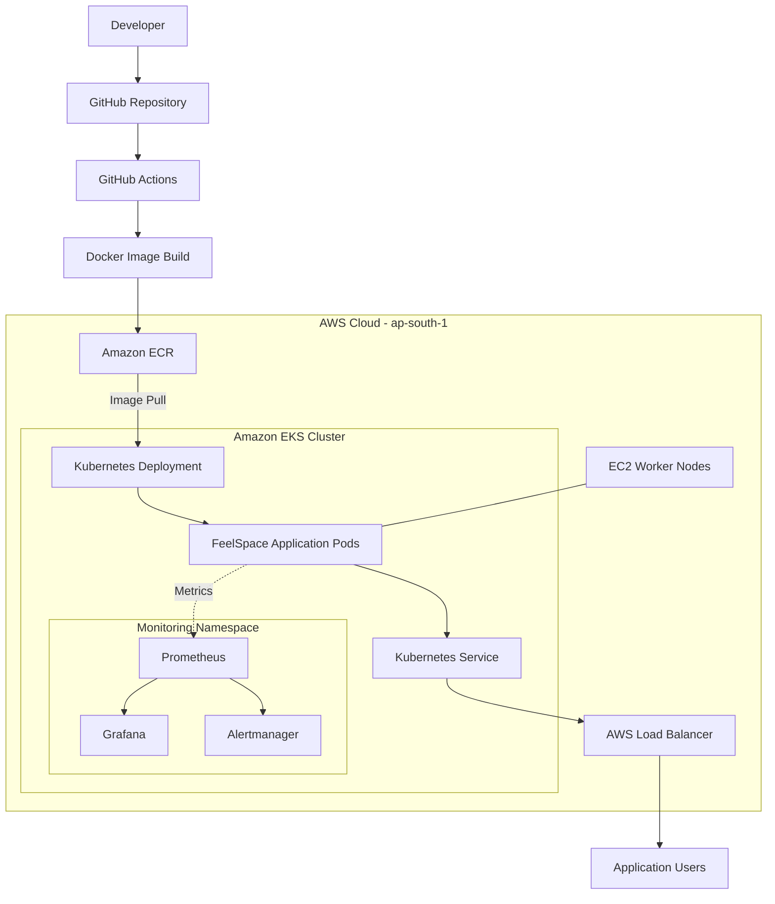

### Application Delivery Workflow

1. Source code is maintained in GitHub.
2. GitHub Actions runs the configured CI/CD workflow.
3. Docker builds the application container image.
4. The image is published to Amazon ECR.
5. The image is used by the Kubernetes application deployment on Amazon EKS.
6. Kubernetes runs the application Pods on EC2 worker nodes.
7. Kubernetes Service and AWS Load Balancer provide external application access.
8. Prometheus collects monitoring metrics, Grafana displays dashboards, and Alertmanager handles alerts.

---

## AWS Cloud Infrastructure

The application is deployed on AWS using Amazon Elastic Kubernetes Service (EKS).

### AWS Services

| AWS Service | Implementation |
|---|---|
| Amazon EKS | Managed Kubernetes control plane |
| Amazon EC2 | Worker-node compute infrastructure |
| Amazon ECR | Docker image repository |
| Amazon VPC | Network environment for the cluster |
| Security Groups | Network traffic control |
| AWS IAM | Identity and access management |
| AWS Load Balancer | External application access |

### Cluster Information

| Configuration | Value |
|---|---|
| AWS Region | ap-south-1 (Mumbai) |
| EKS Cluster | FeelSpace-EKS-Cluster |
| Application Namespace | feelspace |
| Deployment | feelspace-app |
| Container Registry | Amazon ECR |
| Orchestration | Kubernetes |

The application is deployed in a dedicated Kubernetes namespace to keep its resources logically separated from monitoring and other cluster workloads.

---

## Containerization with Docker

Docker is used to package the Flask application and its runtime dependencies into a container image.

This provides a consistent application environment and makes the image suitable for deployment on Kubernetes.

### Containerization Workflow

- Application dependencies are defined for reproducible installation.
- Docker builds the application image.
- The image is tagged for the Amazon ECR repository.
- The container image is published to ECR.
- Kubernetes uses the image to run application Pods.

---

## CI/CD with GitHub Actions

GitHub Actions is used to automate the container image build and publishing workflow.

### Pipeline Workflow

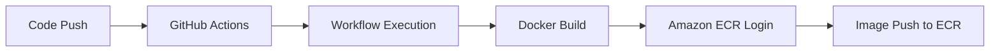

### Pipeline Responsibilities

- Trigger workflow on configured GitHub events.
- Execute the configured build workflow.
- Build the Docker image.
- Authenticate with Amazon ECR.
- Publish the image to the ECR repository.

This reduces the need for manual image-building and publishing steps.

---

## Kubernetes Application Deployment

Amazon EKS provides the Kubernetes environment for running FeelSpace.

The application is deployed using a Kubernetes Deployment and exposed through a Kubernetes Service.

### Kubernetes Components

| Component | Purpose |
|---|---|
| Deployment | Manages application replicas |
| Pods | Run the application containers |
| Service | Provides stable access to application Pods |
| Namespace | Separates application resources |
| Health Probes | Check application health |
| Resource Requests and Limits | Define container resource allocation |

### Container Resource Configuration

| Resource | Request | Limit |
|---|---:|---:|
| CPU | 100m | 500m |
| Memory | 128Mi | 512Mi |

### Application Health

The application provides a `/health` endpoint.

Kubernetes health probes use this endpoint to check application availability and support reliable workload management.

---

## Horizontal Pod Autoscaling

Horizontal Pod Autoscaler (HPA) is configured to automatically adjust the number of application Pods based on CPU utilization.

### HPA Configuration

| Setting | Value |
|---|---:|
| Target CPU Utilization | 70% |
| Minimum Replicas | 1 |
| Maximum Replicas | 3 |
| Scaling Metric | CPU Utilization |

### Load Testing and Scaling

A CPU load test was executed against the application container to observe the autoscaling behavior.

During the test:

1. CPU utilization increased.
2. HPA detected increased CPU usage.
3. Kubernetes increased the application replica count.
4. The deployment scaled up to 3 Pods.
5. After the workload decreased, the replica count returned to 1.

This demonstrated CPU-based horizontal scaling in the EKS environment.

---

## Monitoring and Observability

Monitoring is implemented using the kube-prometheus-stack Helm chart.

The monitoring stack runs in a separate Kubernetes namespace named `monitoring`.

### Monitoring Components

| Component | Responsibility |
|---|---|
| Prometheus | Metrics collection and querying |
| Grafana | Monitoring dashboards and visualization |
| Alertmanager | Alert handling and management |
| Metrics Server | Provides resource metrics for Kubernetes autoscaling |

### Prometheus

Prometheus is used to collect and query monitoring metrics from the Kubernetes environment.

Prometheus targets and alert rules were checked to verify the monitoring configuration.

### Grafana

Grafana is used to visualize application and Kubernetes monitoring metrics through dashboards.

### Alertmanager

Alertmanager receives and manages alerts generated by Prometheus.

### Custom FeelSpace Alert Rules

Two custom Prometheus alert rules were configured for the FeelSpace application.

| Alert | Condition | Duration |
|---|---|---|
| FeelSpaceHighCPU | CPU usage exceeds 80% of the 100m CPU request | 5 minutes |
| FeelSpaceHighMemory | Memory usage exceeds 80% of the 512Mi memory limit | 5 minutes |

Both rules use `warning` severity.

These rules help identify sustained high resource utilization in the application Pods.

---

## Application Technology Stack

| Layer | Technology |
|---|---|
| Frontend | HTML, CSS, JavaScript |
| Backend | Python, Flask |
| Database | PostgreSQL |
| Containerization | Docker |
| Container Registry | Amazon ECR |
| Cloud Platform | AWS |
| Container Orchestration | Amazon EKS, Kubernetes |
| CI/CD | GitHub Actions |
| Autoscaling | Kubernetes HPA |
| Metrics | Prometheus |
| Dashboards | Grafana |
| Alert Management | Alertmanager |

---

## Project Screenshots and Implementation Evidence

The following screenshots document the application, AWS infrastructure, Kubernetes deployment, autoscaling, CI/CD, and monitoring implementation.

### 1. Application Interface

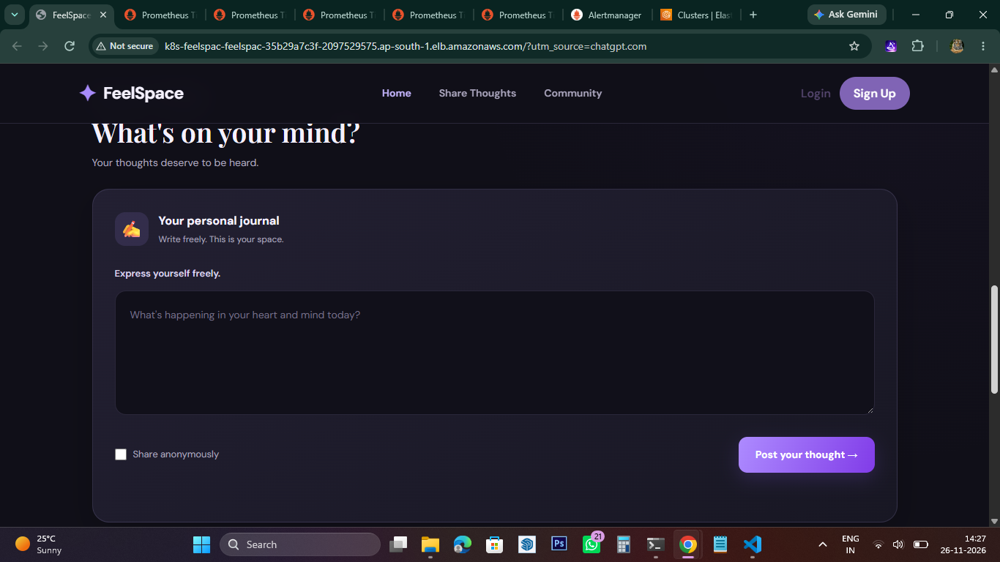

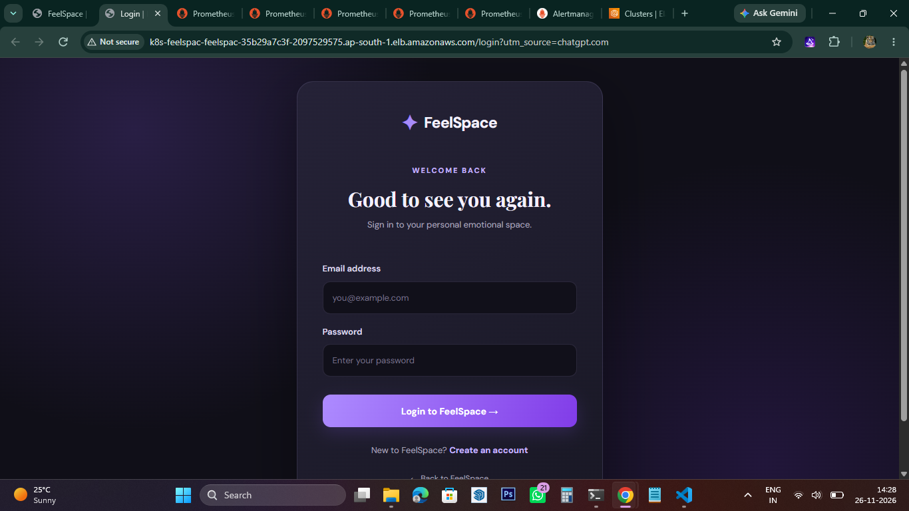

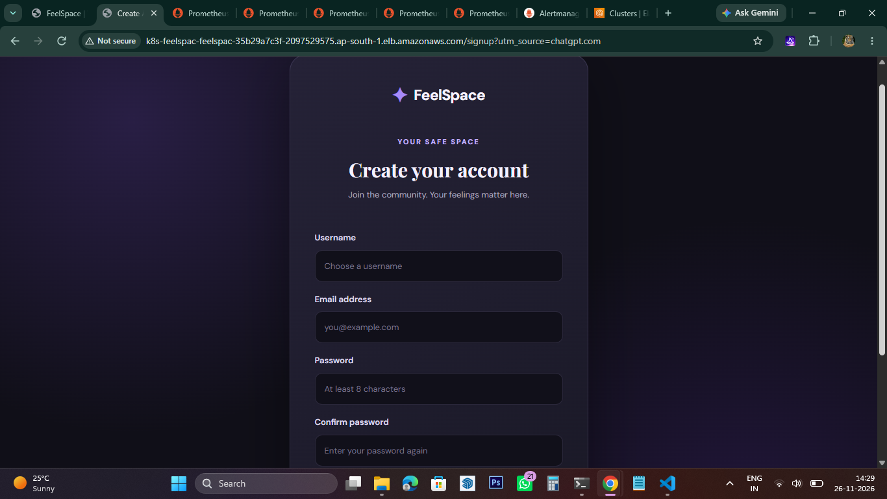

### 2. AWS Infrastructure and Container Registry

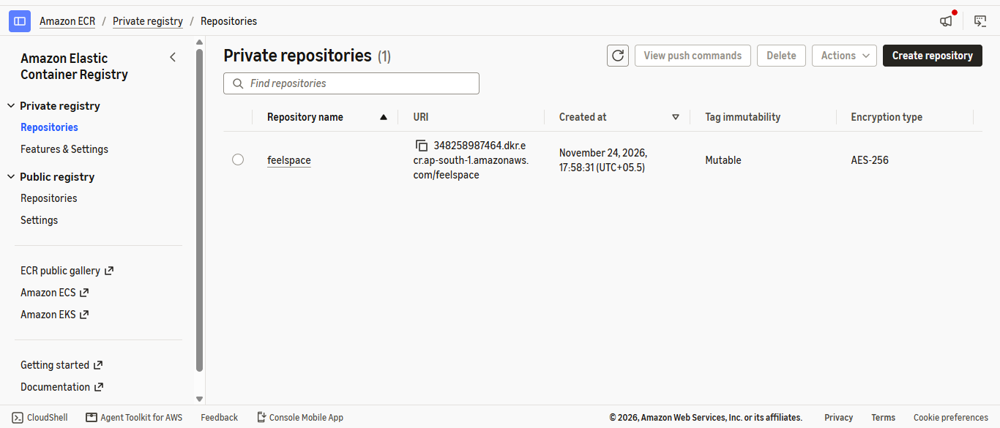

### 3. Kubernetes Deployment

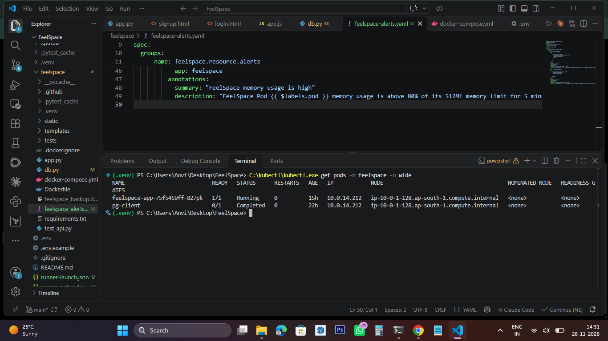

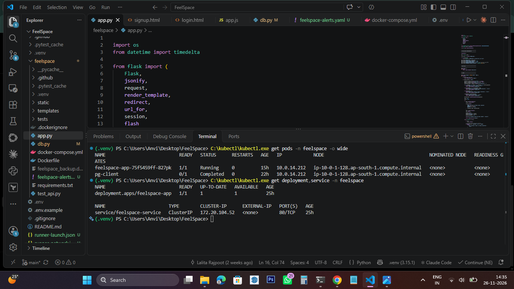

### 4. Horizontal Pod Autoscaling

### 5. Monitoring and Observability

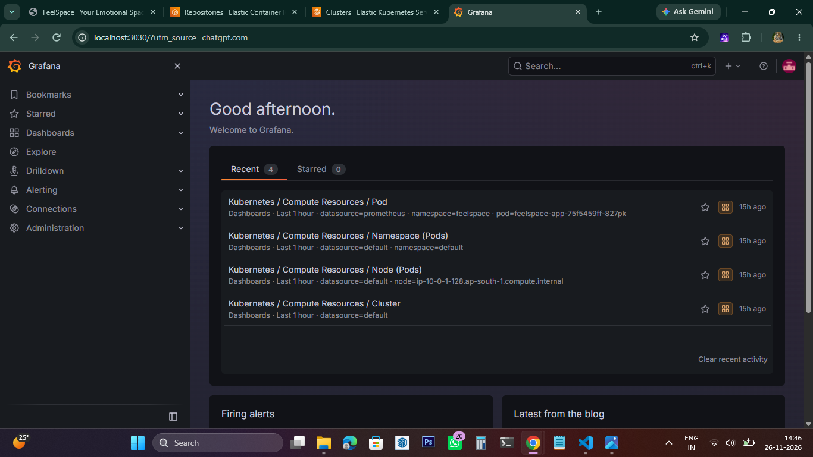

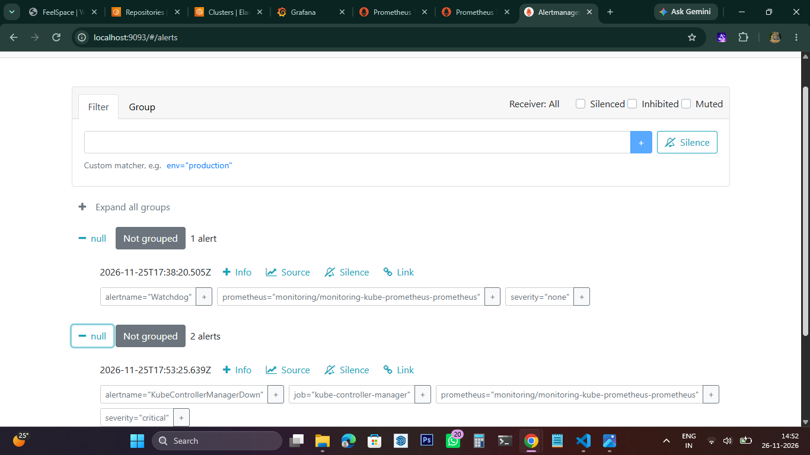

### 6. CI/CD and Source Code

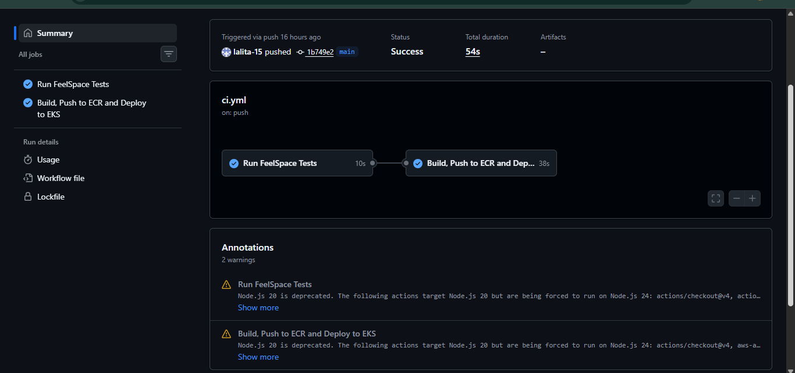

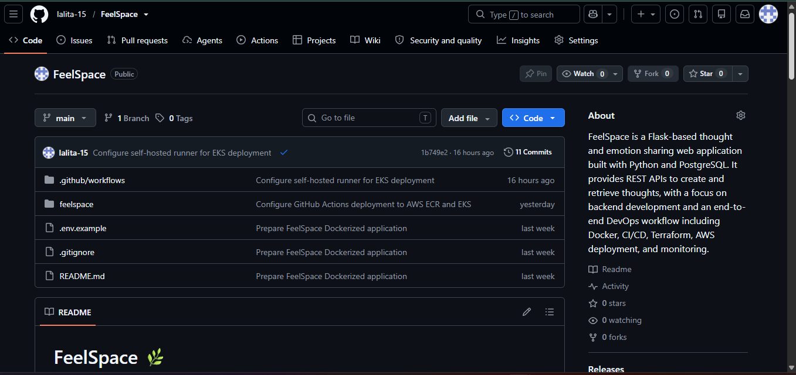

---

## Challenges and Engineering Learnings

Working on FeelSpace helped me understand how application development connects with cloud infrastructure and DevOps practices.

Some of the important areas I worked through included:

- Configuring an AWS EKS environment.
- Building and publishing Docker images to Amazon ECR.
- Deploying and managing application workloads using Kubernetes.
- Troubleshooting application connectivity and database configuration.
- Configuring Kubernetes health probes and resource limits.
- Testing HPA behavior through CPU load generation.
- Installing and configuring the Prometheus monitoring stack.
- Creating and verifying custom Prometheus alert rules.
- Understanding how Kubernetes, AWS networking, and external load balancing work together.

The project also helped me understand the importance of validating each infrastructure component instead of relying only on a successful application response.

---

## Future Improvements

Possible improvements for the next iteration include:

- HTTPS configuration with a custom domain.
- Infrastructure provisioning using Terraform.
- Automated Kubernetes deployment and rollout through CI/CD.
- More advanced monitoring dashboards and alert policies.
- Improved infrastructure security and access controls.

These are future improvements and are not presented as completed implementations.

---

## Live Application

**FeelSpace Application:**

http://k8s-feelspac-feelspac-35b29a7c3f-2097529575.ap-south-1.elb.amazonaws.com

*Note: This is an AWS-hosted endpoint. Availability depends on the AWS infrastructure remaining active.*

---

## Repository

**GitHub:** https://github.com/lalita-15/FeelSpace

---

## Conclusion

FeelSpace began as a web application idea, but it became an opportunity to explore the infrastructure and engineering practices behind running an application in the cloud.

Through this project, I gained practical experience with AWS, Docker, Kubernetes, CI/CD, autoscaling, monitoring, and troubleshooting.

The biggest takeaway was understanding that deploying an application is only one part of the work — keeping it available, observable, and capable of handling changing workloads is equally important.